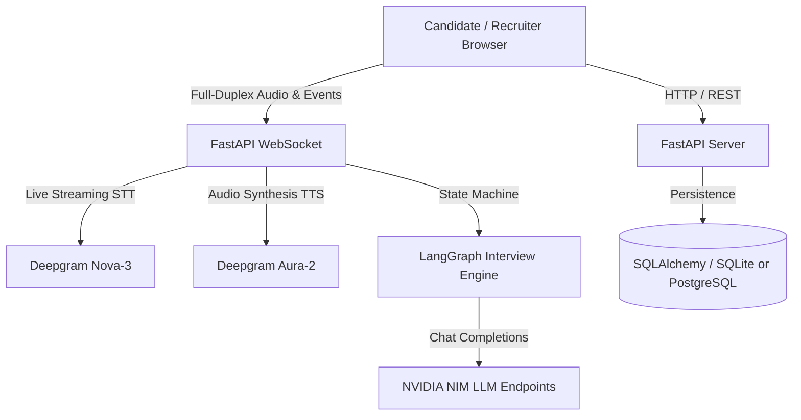

# AI Interview Agent 🎙️🤖

An intelligent, autonomous AI technical screening platform that conducts multi-modal candidate interviews in real-time. Features live webcam previews, voice interaction (Deepgram Nova-3 STT & Aura-2 TTS), adaptive conversational questioning powered by LangChain & LangGraph, and a comprehensive recruiter dashboard with multi-dimensional candidate evaluation scorecards.

---

## 🌟 Key Features

### 1. Multi-Modal Candidate Interview Room
* **Split-Screen Interface**: Left pane shows the candidate's live webcam feed (with Fit / Fill camera framing toggle); right pane shows the real-time transcript stream.
* **Animated AI Interviewer Avatar**: Real-time state indicator reflecting whether the AI interviewer is *idle*, *listening*, *thinking*, or *speaking*.
* **Real-Time Voice Pipeline**:
  * **Text-to-Speech (TTS)**: Spoken questions using Deepgram Aura-2.
  * **Speech-to-Text (STT)**: Low-latency candidate audio transcription using Deepgram Nova-3 with client-side Web Speech recognition fallback for instant visual feedback.
* **Hybrid Turn-Taking Detection**: Automatically detects when the candidate finishes speaking using silence duration detection (2.75s threshold) alongside an explicit manual **Done Answering** button.
* **Text Fallback**: Candidates can seamlessly type their responses if their microphone or audio device experiences issues.

### 2. Adaptive Conversational Brain (LangGraph + LangChain)
* **Grounding in Job Descriptions & Resumes**: Extracts 3–5 core competency topics tailored directly to the JD requirements and the candidate's parsed PDF/DOCX resume.
* **Adaptive Follow-Up Questions**: Probes candidates on trade-offs, edge cases, and architectural choices, with a strict hard cap of max 2 follow-ups per topic to prevent rabbit holes.
* **Anti-Drift & Injection Guardrails**: Fast-path detection against prompt injection ("ignore previous instructions") or off-topic rambling, politely steering candidates back to the core question.
* **Smooth Non-Answer Handling**: If a candidate states "I don't know" or "No experience", the interviewer smoothly transitions forward without stalling or penalizing unnecessarily.

### 3. Recruiter Dashboard & Scorecards
* **Session Management**: Create customized interview sessions with job title, JD text, resume file upload (PDF/DOCX), difficulty level, duration cap, and question quotas.
* **Shareable Links**: Copy unique tokenized interview invitations for candidates.
* **Detailed Analytics & Scorecards**:
  * 4-Dimension scoring per answer: **Relevance**, **Depth**, **Correctness**, and **Communication** (0–10 scale).
  * Aggregated overall rating, hiring recommendation (*Strong Hire*, *Hire*, *Borderline*, *Do Not Hire*).
  * Concrete candidate strengths, identified growth areas, and full timestamped turn-by-turn transcripts.

---

## 🛠️ Architecture & Tech Stack



* **Frontend**: React 19, TypeScript, Vite, Tailwind CSS, Lucide Icons.
* **Backend**: FastAPI, LangChain, LangGraph, Pydantic, SQLAlchemy.
* **Voice Services**: Deepgram SDK (Nova-3 STT & Aura-2 TTS).
* **LLM Endpoints**: NVIDIA NIM API (`nvidia/nemotron-3.5-lightning-30b-a3b` or any compatible ChatOpenAI endpoint).
* **Database**: Zero-config SQLite default for development; PostgreSQL-ready for production.

---

## 🚀 Quick Start

### 1. Clone & Setup Repository
```bash
git clone https://github.com/sushantsk1/interview-agent.git
cd interview-agent
```

### 2. Configure Environment Variables
Copy `.env.example` to `.env` and fill in your API credentials:
```bash
cp .env.example .env
```
Contents of `.env`:
```env
DEEPGRAM_API_KEY=your_deepgram_api_key
NVIDIA_API_KEY=your_nvidia_api_key
NVIDIA_MODEL=nvidia/nemotron-3.5-lightning-30b-a3b
DATABASE_URL=sqlite:///./interview_agent.db
FRONTEND_URL=http://localhost:5173
```

### 3. Backend Setup
```bash
# Create and activate virtual environment
python -m venv .venv
source .venv/bin/activate  # On Windows: .\.venv\Scripts\Activate.ps1

# Install backend dependencies
pip install -r backend/requirements.txt

# Start backend server
uvicorn backend.app.main:app --host 0.0.0.0 --port 8000 --reload
```

### 4. Frontend Setup
```bash
cd frontend
npm install
npm run dev
```
Open **`http://localhost:5173`** in your browser.

---

## 🧪 Testing

### Backend Test Suite (Pytest)
```bash
pytest backend/tests/ -v
```
*Includes 41 comprehensive tests across REST APIs, WebSocket protocols, LangGraph state machine transitions, resume parsing, and mock offline voice services.*

### Frontend Test Suite (Vitest)
```bash
cd frontend
npm test -- --run
npm run build
```
*Includes 51 unit & component tests covering webcam previews, audio player/recorders, silence timers, chat transcripts, and recruiter dashboard views.*

---

## 📄 License
MIT License. Built with ❤️ for automated, objective, and empathetic technical hiring.

